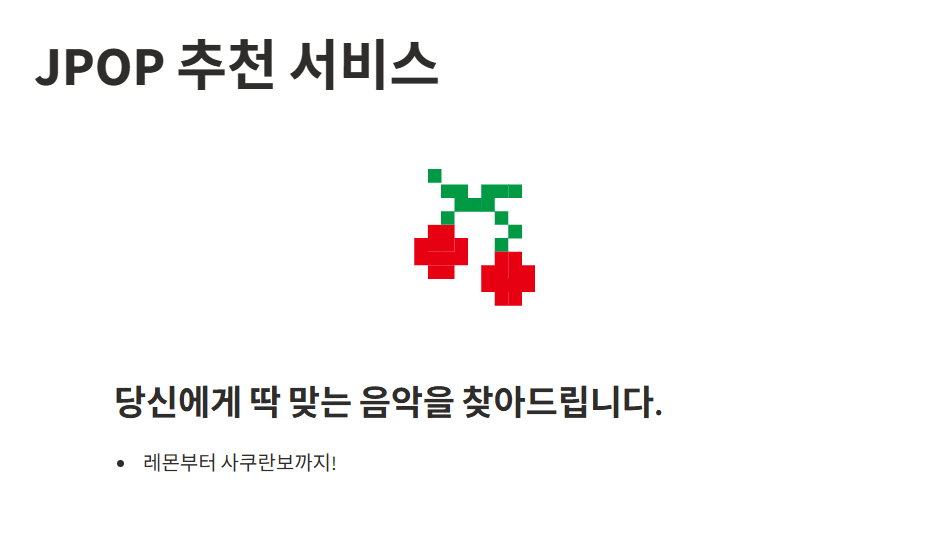
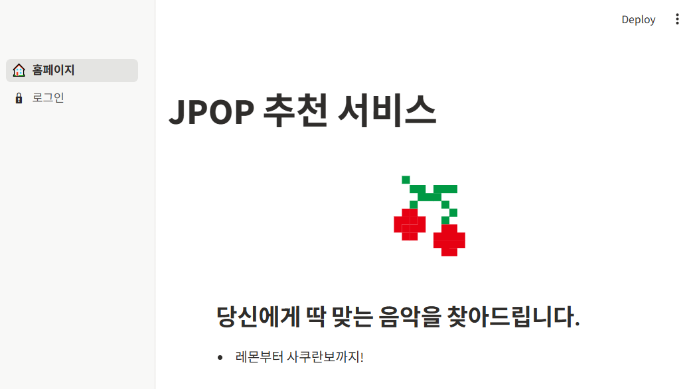
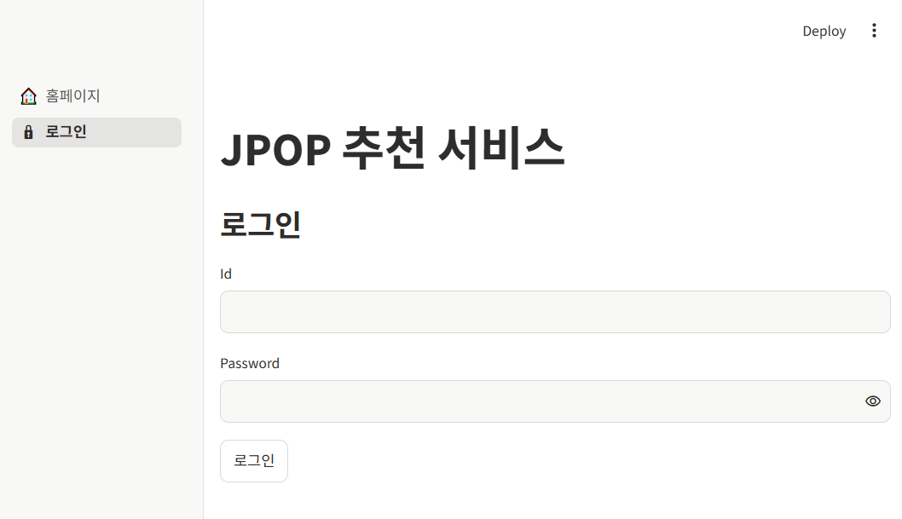
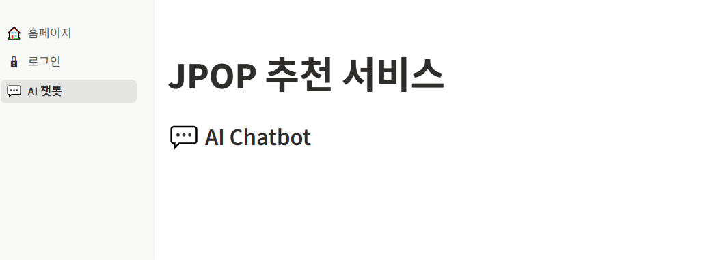

## 사전 준비물
- python 3.11 이상
- gemini api 키
- git, pip 사용 가능 환경

## 설치 방법
1. 저장소 복제 or 소스코드 다운
2. 가상환경을 만들고 활성화
```bash
python -m venv .venv
source .venv/Scripts/activate
```
3. 필요한 패키지 설치
```bash
pip install -r requirements.txt
```

### 과정
- app.py

- 인덱스 페이지 생성
    

- 로그인 페이지 작성
    
    

- ai 챗봇 페이지 작성 
    (본격적 기능 구현 전 간단 페이지만 생성)
    
